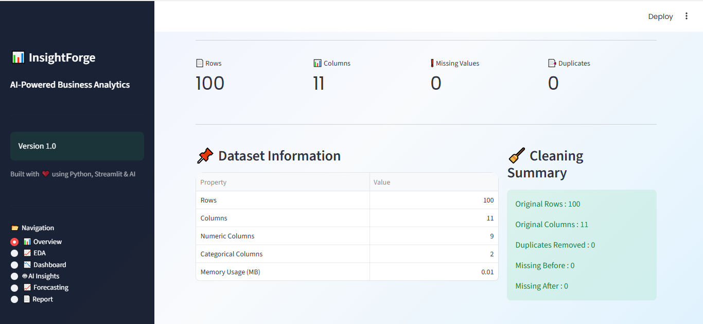
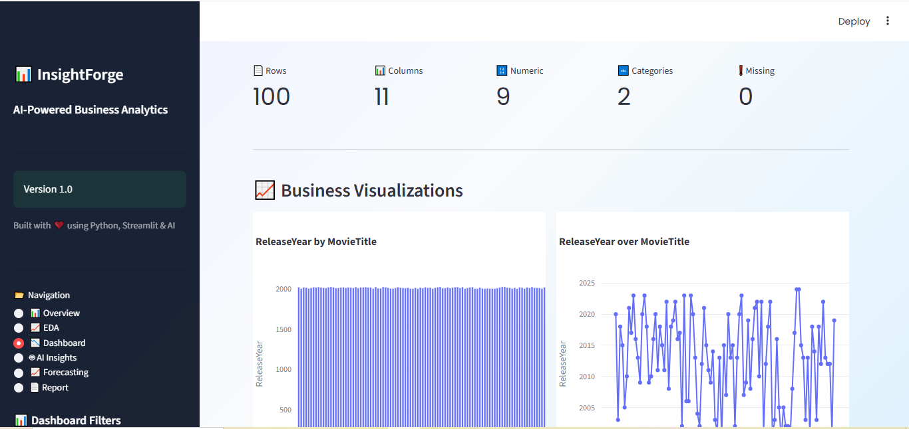
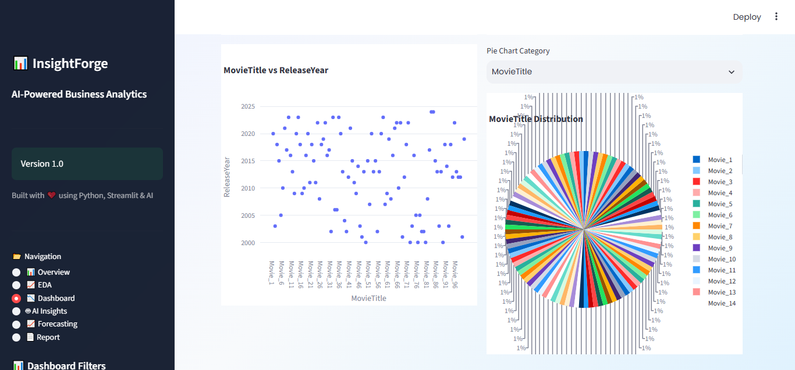
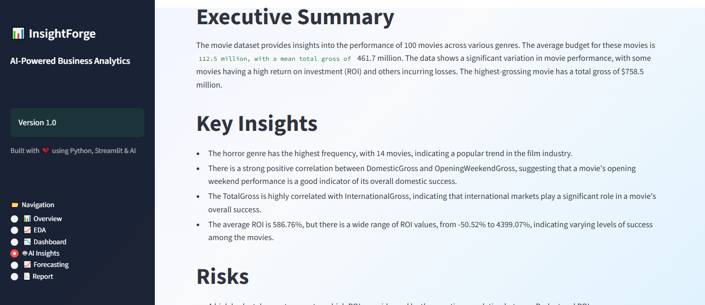
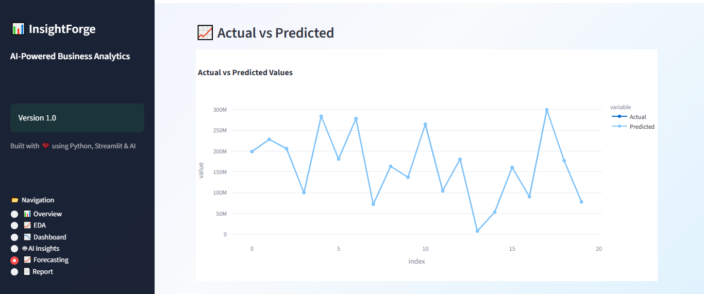
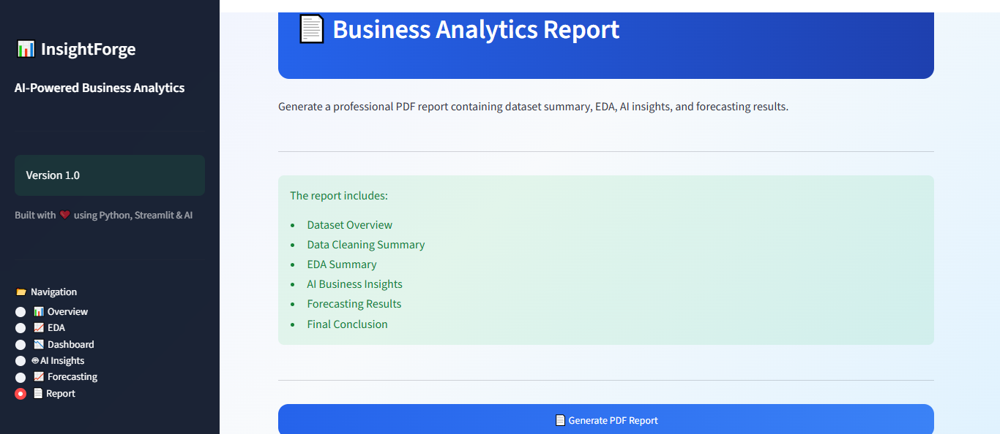

# 📊 InsightForge – AI-Powered Business Analytics Platform

## Overview

InsightForge is an AI-powered Business Analytics Platform that enables users to upload CSV or Excel datasets and automatically perform data cleaning, exploratory data analysis (EDA), interactive dashboard generation, AI-powered business insights, trend forecasting, and professional PDF report generation.

The platform simplifies the complete data analytics workflow, helping users transform raw data into meaningful business insights through automation and machine learning.

---

# Features

### Data Upload
- Upload CSV and Excel datasets
- Automatic dataset validation
- Support for multiple business datasets

### Data Cleaning
- Missing value handling
- Duplicate removal
- Automatic data type correction
- Dataset quality summary

### Exploratory Data Analysis (EDA)
- Statistical summary
- Correlation matrix
- Missing values report
- Dataset overview

### Interactive Dashboard
- KPI Cards
- Bar Charts
- Line Charts
- Scatter Plots
- Dynamic chart configuration using Plotly

### AI Business Insights
- AI-generated dataset analysis
- Business recommendations
- Trend interpretation
- Executive summary generation using Groq/OpenAI

### Forecasting
- Linear Regression-based trend prediction
- Model performance metrics
- Future trend analysis

### PDF Report Generation
- Professional analytics report
- Dataset overview
- Cleaning summary
- EDA summary
- AI-generated insights
- Forecasting results

---

# Tech Stack

## Frontend
- Streamlit

## Backend
- Python

## Data Analysis
- Pandas
- NumPy

## Data Visualization
- Plotly
- Matplotlib

## Machine Learning
- Scikit-learn
- Linear Regression

## AI Integration
- Groq API
- OpenAI API

## Report Generation
- ReportLab

---

# Workflow

```
Upload Dataset

↓

Automatic Data Cleaning

↓

Exploratory Data Analysis (EDA)

↓

Interactive Dashboard

↓

AI Business Insights

↓

Machine Learning Forecasting

↓

PDF Report Generation
```

---

# Project Structure

```
InsightForge/

│── app.py
│── requirements.txt
│── README.md
│── .gitignore

├── assets/
│     └── style.css

├── data/

├── modules/
│     ├── upload.py
│     ├── cleaning.py
│     ├── eda.py
│     ├── dashboard.py
│     ├── ai_insights.py
│     ├── forecasting.py
│     └── report.py

├── pages/
│     ├── overview.py
│     ├── eda_page.py
│     ├── dashboard_page.py
│     ├── ai_page.py
│     ├── forecast_page.py
│     └── report_page.py

└── reports/
```

---

# Key Features Demonstrated

- Data Cleaning & Preprocessing
- Exploratory Data Analysis (EDA)
- Interactive Business Dashboards
- KPI Generation
- AI-powered Business Insights
- Machine Learning Forecasting
- Automated PDF Reporting
- Modular Python Application Development

---

# Installation

Clone the repository

```bash
git clone https://github.com/mihikaP23/InsightForge.git
```

Move into the project directory

```bash
cd InsightForge
```

Install dependencies

```bash
pip install -r requirements.txt
```

Run the application

```bash
streamlit run app.py
```

---

# Screenshots

## Overview



## Dashboard





## AI Insights



## Forecasting



## PDF Report



---

# Future Enhancements

- Multiple Machine Learning Models
- Dataset Comparison
- Data Quality Score
- AI Chat with Dataset
- Advanced Dashboard Customization
- User Authentication
- Streamlit Cloud Deployment

---

# Author

**Mihika Pargai**

B.Tech Computer Science (Hons.) – Data Science  
University of Petroleum and Energy Studies (UPES), Dehradun

---
